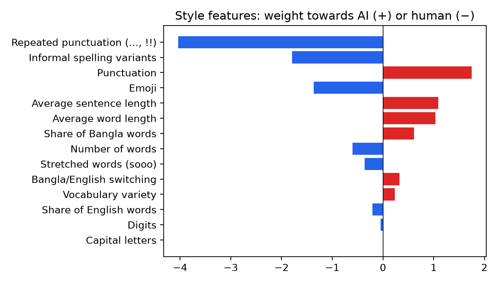
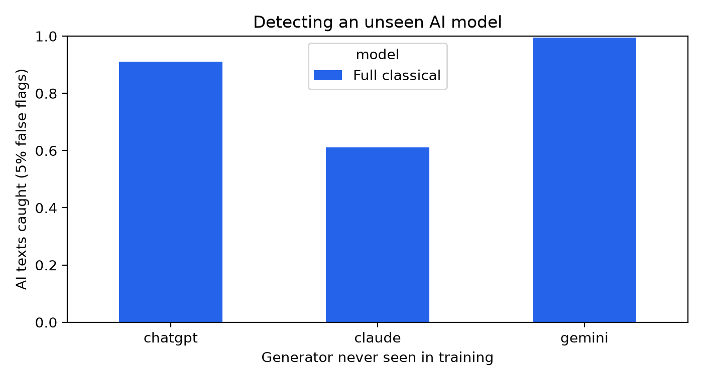

# BanglishCheck: Explainable AI-Generated Text Detection for Banglish

Research Den Fall 2026 technical project.

BanglishCheck is a web app that takes a Banglish text (Bangla written in English letters, often mixed with
English) and estimates whether a person or an AI model wrote it. It also shows **why**: which words pushed
the score towards AI or human, and which writing-style signals mattered.

| | |
|---|---|
| **Live demo** | `TODO: Hugging Face Space link` |
| **Demo video** | `TODO: link` |
| **Technical report** | `TODO: link` |

## Why build this

Most AI-text detectors are trained on English. Banglish has no fixed spelling ("valo", "bhalo", "balo"), mixes
two languages in one sentence, and is mostly short and informal, so English detectors misjudge it. A detector
that gives only a score is also risky: a wrong "AI" label can be used to accuse a real person. BanglishCheck is
built to show its evidence so a user can judge the score instead of trusting it blindly.

## System design

```
CSV data ──► cleaning + length matching ──► train / val / test split
                                                 │
                     ┌───────────────────────────┴───────────────────────────┐
                     ▼                                                       ▼
   Classical detector (deployed)                              Transformer detector (comparison)
   word n-grams + char n-grams + 14 style features           XLM-RoBERTa fine-tuned
   → logistic regression                                      → Integrated Gradients (Captum)
   → exact SHAP values per word and feature
                     │
                     ▼
   explainer.joblib ──► Gradio app on Hugging Face Spaces
                         • AI / human probability
                         • words highlighted red (AI-like) or blue (human-like)
                         • bar chart of writing-style signals
                         • warning for very short texts
```

The deployed model is the classical one: it is as accurate as the transformer on this data, runs on a free CPU,
and its explanations are exact rather than approximate.

## Tech stack

| Part | Tools |
|---|---|
| Data and features | Python, pandas, regular expressions, custom Banglish word lists |
| Classical models | scikit-learn (TF-IDF, FeatureUnion, LogisticRegression) |
| Explanations | Linear SHAP (computed exactly from the model's weights), Captum Integrated Gradients |
| Transformer | Hugging Face Transformers, XLM-RoBERTa base, Google Colab T4 GPU |
| Demo | Gradio 6, Hugging Face Spaces (free CPU) |

## Data

| Source | Texts | Notes |
|---|---|---|
| Human | 1,638 | Banglish product reviews from BanglishRev, posted before 30 Nov 2022 (ChatGPT's release) |
| ChatGPT | 783 | Generated Banglish e-commerce reviews |
| Claude | 667 | Generated Banglish e-commerce reviews |
| Gemini | 188 | Generated Banglish e-commerce reviews |

- Reviews with Bangla script, under 5 words or over 60 words are removed.
- Human texts are sampled to match the AI texts' lengths, so the model can't win just by counting words.
- Split: 70% train, 15% validation, 15% test, keeping each source's share the same in every split.
- The raw data is not in this repository.

## Results

Test set: 492 texts (246 human, 246 AI). "AI caught" uses a threshold set so that 5% of human validation texts
are flagged.

| Model | Accuracy | AUROC | AI caught at 5% false flags |
|---|---|---|---|
| Length only | 61.0% | 0.679 | 16.3% |
| Style features only | 87.4% | 0.942 | 72.8% |
| Word n-grams + LR | 96.1% | 0.995 | 97.2% |
| Char n-grams + LR | 97.4% | 0.998 | 98.8% |
| **Full classical (deployed)** | **96.5%** | **0.996** | **99.6%** |
| XLM-R (fine-tuned) | `TODO from Colab` | | |

**Unseen AI model test.** Train on two AI models, test on the third:

| Left out | AUROC | AI caught at 5% false flags |
|---|---|---|
| Claude | 0.938 | 61.0% |
| ChatGPT | 0.978 | 91.1% |
| Gemini | 0.996 | 99.5% |

The detector drops sharply on Claude when it has never seen Claude's writing, so a detector trained on a fixed set
of AI models should not be trusted on new ones.

**Are the explanations faithful?** Deleting the 5 words the explainer ranks highest drops the model's confidence by
0.45 on average, against 0.15 for 5 random words. The highlighted words really are what the model relies on.

**What the model learned:** human reviews use repeated punctuation ("..", "!!"), informal spellings and emoji.
AI reviews use tidier punctuation and longer words and sentences.




## Repository

| Path | What it is |
|---|---|
| `notebooks/BanglishCheck_Colab.ipynb` | Full pipeline in Colab: data, models, explanations, tests, figures, demo files |
| `banglishcheck.py` | Shared code: cleaning, features, models, metrics, the explainer |
| `app/` | The Gradio demo for Hugging Face Spaces |
| `docs/figures/` | Figures used in this README and the report |

## Run it

**Full pipeline:** upload the four CSV files to `MyDrive/banglishcheck/data/`, open the notebook in Colab with a
T4 GPU, and choose Run all. Results go to `MyDrive/banglishcheck/outputs/`.

**Demo locally:**

```bash
cd app
pip install -r requirements.txt
# put banglishcheck.py and explainer.joblib (from outputs/space/) next to app.py
python app.py
```

## Limitations and future work

- Human texts are all product reviews, so the app may be less reliable on other Banglish writing.
- Texts under 8 words are unreliable, and the app warns about them.
- Paraphrased or human-edited AI text is not tested yet.
- Only 188 Gemini texts. More data from more AI models would make the detector more robust.
- The detector must never be used on its own to accuse anyone of using AI.

## References

- BanglishRev dataset: `TODO: add the citation`
- Conneau et al., 2020. Unsupervised Cross-lingual Representation Learning at Scale (XLM-R).
- Lundberg and Lee, 2017. A Unified Approach to Interpreting Model Predictions (SHAP).
- Sundararajan et al., 2017. Axiomatic Attribution for Deep Networks (Integrated Gradients).
- Abid et al., 2019. Gradio: Hassle-Free Sharing and Testing of ML Models in the Wild.
